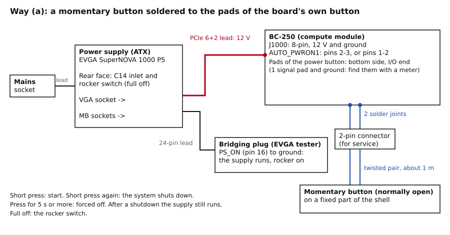
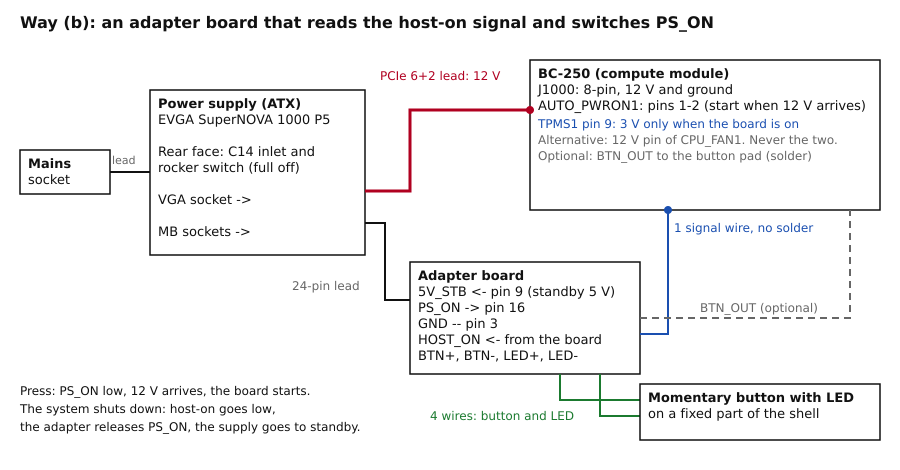
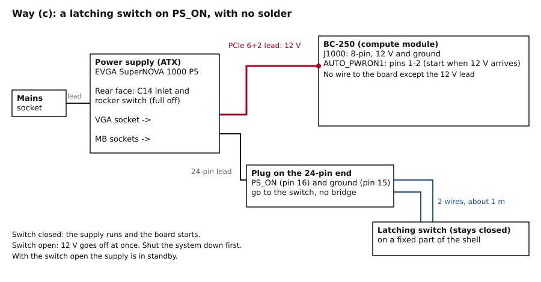

# The everyday power button and the power supply

Research date: 2026-11-14. Each source was read on this date unless the text gives a different date.

This note answers the open decision "The everyday power button" in `docs/roadmap.md`. It gives what the
BC-250 and the power supply (EVGA SuperNOVA 1000 P5) do when the system starts and stops, the three
ways to fit a button, the adapter boards that exist, and what the shell must have for a button.
It extends `docs/research/bc250-cooling-and-psu.md` (Part B, "Starting the PSU without a motherboard").

Nothing was tested for this note. No part was bought. Section 10 lists the bench tests that decide.

## Status tags

| Tag | Meaning |
| --- | --- |
| SOURCED [id] | Written in the source with that number in section 11. The page was read. |
| SOURCED (summary) | Read in a search-result summary only. The page was not read. |
| MAKER [id] | From the maker of the part: a data sheet, a wiring diagram or a product page. |
| MEASURED-FROM-CAD | Measured from a community CAD file in an earlier note. The note is named. |
| STANDARD | From a published specification. The specification is named. |
| ESTIMATED | Calculated or reasoned here. The method is given. |
| PROVISIONAL | A design value proposed here. A test or the owner can change it. |
| NOT CONFIRMED | No source says it, or the sources do not agree. A test must show it. |

The community documents are written by users. A statement in them is a report, not a measurement,
unless the text says who measured it.

## 1. Summary

1. The roadmap text is correct, with three changes. The solder points are the pads of the board's
   button on the bottom side of the board. One signal pad and ground are sufficient. An adapter for
   the 24-pin ATX connector is now in the maker's shop, as a pre-order that was sold out on
   2026-11-14.
2. The adapter needs no solder. It reads a pin that has a voltage only while the board is on:
   pin 9 of the header `TPMS1` (3 V), or the 12 V pin of `CPU_FAN1`. It must not be connected to the two
   pins at the same time.
3. A momentary button directly on `PS_ON` does not work. The supply stops when the button is released.
4. After a shutdown, the board stays in a soft-off state as long as 12 V is there. It does not
   switch the supply. With way (a) the supply thus runs until a person sets the rocker switch to off.
   The draw in that state is not known. The estimate is 15 W to 20 W from the wall.
5. With way (b) or way (c) the supply goes to standby (about 0.2 W to 0.5 W from the wall). All
   that the supply feeds goes off with it: the hub, the marquee, the amplifier.
6. Recommendation: way (b), an adapter with a momentary button of 16 mm. Way (c), a latching button
   of 16 mm in the same hole, is the fallback and the first bench set-up. The hole and the place of the
   button are then the same for the two ways, so the shell does not wait for this decision.

## 2. The roadmap statements, confirmed or corrected

| Statement in the roadmap | Result | Evidence |
| --- | --- | --- |
| The board has no header for a power button. | Confirmed. | SOURCED [B1][B2][B4][B6]. The connector reference [B3] lists each header and has no such header. |
| The board starts when 12 V arrives. Jumper `AUTO_PWRON1`: pins 1-2 start the board, pins 2-3 make it wait for the button. | Confirmed. Pins 1-2 are the default. | SOURCED [B3][B2][B6]. One builder uses pins 2-3 on his board [B6]. |
| Two wires soldered to the two sides of the board's button give a momentary switch. | Confirmed, with a correction. The solder points are the pads of the button on the bottom side of the board. One wire goes to the signal pad and one to ground. | MAKER [A2] ("solder point: BC250 bottom side, at the power/reset button solder pads"). SOURCED [B6] ("a wire pair to the power button and a ground"). SOURCED [B1]. |
| A short press starts the board. A second press shuts it down. 5 s forces it off. | Confirmed by two documents and one builder. No source gives a measured time. | SOURCED [B1] ("Hold for 5+ seconds for hard power-off"), [B6] ("A momentary press will either turn on the BC-250, or trigger a graceful shutdown. A long press will force a hard shutdown."). |
| A bought adapter reads the board's `HOST_ON` signal and switches `PS_ON`. | Confirmed. `HOST_ON` is the maker's name for the input of the adapter, not for a pin of the board. The pin on the board is `TPMS1` pin 9 or the 12 V pin of `CPU_FAN1`. | MAKER [A2]. SOURCED [B2][B5]. |
| The 24-pin ATX version of the adapter was not finished. | Changed. The shop lists two 24-pin editions. The one with a button was a pre-order and sold out on 2026-11-14. The maker's repository still calls the 24-pin version "work in progress" (last change 2026-05-06). | MAKER [A1][A3][A4] |
| A latching switch on `PS_ON` needs no solder. It is a hard on and off. | Confirmed. | SOURCED [B7][B2]. STANDARD [P1]. |

## 3. The board

### 3.1 The button and its pads

| Item | Value | Status |
| --- | --- | --- |
| Buttons on the board | Two lit momentary buttons on the I/O edge, beside the I/O ports. The power button glows green. The reset button glows blue and is recessed. | SOURCED [B6] (one builder, his own board) |
| Position of the button body | On the I/O edge, 18.6 mm to 27.0 mm from the straight long edge. It stands 4.2 mm beyond the I/O edge and 22.85 mm above the top face of the board. | MEASURED-FROM-CAD in `docs/research/hardware-envelopes.md` section 2. The community model has one body for the two buttons. |
| Solder points | The pads of the button, on the bottom side of the board (the backplate side). The backplate starts 17.1 mm from the I/O edge, so it does not cover the pads. | MAKER [A2]. The backplate value is MEASURED-FROM-CAD (same section). That the pads are free of the backplate is ESTIMATED from these two facts. |
| Which pad | NOT CONFIRMED in text. The maker's diagram marks one pad of the group. A user writes that the power button is "one side by side pair" and the reset "another pair". Find the pad with a continuity meter: the signal pad connects to ground only while the button is pressed. | MAKER [A2] (a picture). SOURCED (summary) [B8]. |
| Wires | One wire to the signal pad and one to ground. The ground wire can go to a ground pad of the button or to a different ground point. | SOURCED [B6]. SOURCED (summary) [B9] ("you just need 1 soldered wire on the board at the back of the power button"). |
| In this cabinet | The button is inside the exhaust duct, and a person cannot reach it. The pads face the front of the cabinet, behind the board. Solder on the bench, before the board goes into its carrier. | `docs/research/bc250-cooling-and-psu.md` A7. The direction follows from decision record 0005 (the heatsink is toward the rear door). |

### 3.2 The jumper `AUTO_PWRON1`

| Item | Value | Status |
| --- | --- | --- |
| Type | Three pins. Pin 1 has a small triangle on the board. | SOURCED [B3][B6] |
| Pins 1-2 | The board starts when 12 V arrives. This is the default. | SOURCED [B3][B2] |
| Pins 2-3 | The board waits for a press of its power button. | SOURCED [B3][B2] |
| A side effect of pins 2-3 | "This mode also keeps the BC-250's USB ports energized while the ATX power supply is on." | SOURCED [B6] (one builder) |
| Position on the board | Between the M.2 socket and the jumper `CLRCMOS1`, on the straight long edge. The connector reference lists the connectors clockwise from the M.2 socket, and `AUTO_PWRON1` is the first after it. The fin block has a notch for "the CR2032 holder and jumpers" at the far corner on that edge. | ESTIMATED from the order in [B3] and from `docs/research/hardware-envelopes.md` section 2. Confirm on the board. |
| In this cabinet | The notch is under the floor of the fan shroud. Set the jumper before the shroud goes on. | `docs/research/bc250-cooling-and-psu.md` A7 |
| Does the button start the board again after a shutdown, with the jumper on pins 1-2? | NOT CONFIRMED. No source says that the jumper must move for the button to work. One user suggests pins 2-3 with the button. | SOURCED [B1] (the button method has no jumper step). SOURCED (summary) [B10]. Bench test 3. |

### 3.3 Signals that show that the board is on

| Signal | Value | Status |
| --- | --- | --- |
| `TPMS1` pin 9 (3 V) | "is active only when the board is powered on, making it suitable for relay or control circuit applications that need to detect system power state" | SOURCED [B2]. The maker's adapter and one more project use it [A2][B5]. |
| `CPU_FAN1`, 12 V pin | On when the board is on, off when it is off. Two adapter designs use it as the host-on signal. | MAKER [A2]. SOURCED [A5] ("BC250 ON (12 V) ... BC250 OFF (0 V)"). |
| `LED1`, `LED2` on `J2000` | Logic outputs that follow the red and green LED on the I/O edge. Do not put an LED on them directly. | SOURCED [B2] (measured by one user on one board) |
| `TPMS1` pitch | 2.0 mm, 18 pins. A common jumper wire has a pitch of 2.54 mm. Use a socket for 2.0 mm pins. | SOURCED [B3] |

The two host-on pins have different voltages: 3 V and 12 V. The maker's diagram has the warning: "use only one connector. Simultaneous connection of both will
result in board damage." MAKER [A2].

## 4. What the board does at a shutdown

| Question | Answer | Status |
| --- | --- | --- |
| Does the board switch the power supply? | No. "The BC-250 does not have any circuits for powering on the attached ATX power supply." It has no `PS_ON` output. | SOURCED [B6][B2][A5] |
| Does 12 V stay on after a shutdown? | Yes, as long as the supply runs. Only a switch on `PS_ON`, an adapter or the rocker stops the 12 V. | STANDARD [P1] (section 3.3.2). SOURCED [B6] ("I'm leaving the power supply turned on at all times"). |
| Does the board cut its own load? | It cuts the main load. The 3 V on `TPMS1` pin 9 and the 12 V of the fan header go off, so the fan stops. | SOURCED [B2]. MAKER [A2]. That the fan stops is ESTIMATED from the 12 V pin. |
| What stays on? | A converter on the board makes 5 V for standby from the 12 V. The LED on the I/O edge stays lit. With the jumper on pins 2-3 the USB ports keep their 5 V. | SOURCED [B4] ("internal 12V-to-5V standby converter"), [B6] |
| How much does the board draw when it is off? | NOT CONFIRMED. One user writes that two chips draw "up to around 10W" when the board is off. No document has a measurement. | SOURCED (summary) [B11] (one user) |
| Is there a sleep state? | No. Suspend does not work. A "Sleep" command leaves the board at full power with a black screen. | SOURCED [B6][B4]. See also `docs/research/pc-panel-and-front-usb.md` A1. |

Thus a shutdown from the menu of the operating system is a full stop for the software only. The 12 V
input stays live until something switches the supply.

## 5. What the power supply does

The supply is the EVGA SuperNOVA 1000 P5. No test report of this model was found. The numbers that
follow are those of its sister unit, the 1000 G5, from one test laboratory [P2]. The P5 has a
better efficiency class, so its losses are probably smaller. ESTIMATED.

| Fact | Value | Status |
| --- | --- | --- |
| `PS_ON` | Active low. Low: the main rails are on. High or open: the main rails are off. The supply has its own pull-up. | STANDARD [P1] section 3.3.2 |
| Standby 5 V | "is always enabled whenever the AC power is present". `PS_ON` has no effect on it. | STANDARD [P1] sections 3.3.2 and 3.3.3 |
| Draw in standby, no load on the standby 5 V | 0.17 W at 115 V, 0.26 W at 230 V (sister unit) | SOURCED [P2] |
| Draw with 20 W of load on the main rails | 29.8 W at 115 V, 29.0 W at 230 V (sister unit). The loss is about 10 W. | SOURCED [P2] |
| Fan with ECO on | 0 rpm at 20 W, 40 W, 60 W, 80 W, 100 W and 200 W (sister unit) | SOURCED [P2] |
| Fan with ECO off | The fan always turns while the main rails are on. | MAKER (EVGA manual, in `docs/research/bc250-cooling-and-psu.md` Part B, source S2) |
| Fan in standby | Off. The main converter is off. | ESTIMATED from [P1]: the fan has no supply |
| The rocker switch | On the rear face, beside the C14 inlet. It disconnects the mains. | `docs/research/bc250-cooling-and-psu.md` Part B |

The state after a shutdown, for each way:

| | Way (a): button on the board, bridging plug | Way (b): adapter | Way (c): latching switch on `PS_ON` |
| --- | --- | --- | --- |
| Main rails after the system shuts down | On | Off. The adapter releases `PS_ON` when the host-on signal goes away. | On, until a person opens the switch. Then off. |
| Supply fan | Off with ECO on (sister unit data). On with ECO off. | Off | As (a) until the switch is open, then off |
| Draw from the wall | NOT CONFIRMED. About 15 W to 20 W. ESTIMATED: a board draw of 5 W to 10 W (one user report) and about 10 W of loss in the supply. | About 0.2 W to 0.5 W. ESTIMATED: 0.17 W plus the adapter and its LED (15 mA at 5 V). | As (a), then about 0.2 W |
| The hub, the marquee, the amplifier (all fed by the supply) | Stay on | Go off | Stay on, then go off |
| Is the rocker the only full off? | Yes. Only the rocker (or the mains plug) stops the supply. | No. The supply goes to standby without the rocker. The rocker gives 0 W. | No, as (b), after the switch is open |
| Energy in one year, if the rocker stays on | About 130 kWh to 175 kWh. ESTIMATED: 15 W to 20 W for 8760 h. | About 2 kWh to 4 kWh | About 2 kWh, if the switch is always opened |

Two statements in the community documents do not agree with the standard or with the maker of the supply.
This note does not use them:

- "Connect PS_ON ... to +5VSB (purple wire), NOT to COM/GND" [B12]. The standard says that a low level
  on `PS_ON` starts the supply [P1]. A connection to the standby 5 V keeps the supply off.
- "Standard ATX PSUs without motherboard control will run fans at 100% speed continuously" [B2]. The
  fan of this supply follows the load of the supply (EVGA manual), and the test of the sister unit
  shows 0 rpm at low load [P2].

## 6. Adapter boards

| Board | For which supply connector | Buy or build | What it does | Not confirmed |
| --- | --- | --- | --- | --- |
| mosfet.party "ps_on adapter - ATX 24pin edition + button" | 24-pin ATX | Buy. USD 45.00 (EUR 41.95). "preorder sale", "Sold out" on 2026-11-14. | "plug-n-play version of the adapter board that lets you use any ATX 24pin power supply with BC250 without shorting the green PS_ON wire". It "comes pre-wired with all connection cables and a 16mm panel-mount backlit power button". MAKER [A3][A4] | If it ships, and when. The cable lengths. If it reads `TPMS1` or the fan header. The maker's repository has no diagram for this edition. |
| mosfet.party "ps_on adapter - ATX 24pin edition + PC case headers" | 24-pin ATX | Buy. USD 43.00. | Not read. The name says that it has pin headers for the button and the LED of a PC case. MAKER [A4] (name and price only) | The product page was not read (the shop refused more requests). Stock. |
| mosfet.party "ps_on adapter - LITE/DIY edition" (version 1.3 in the diagram) | Each supply with `PS_ON` and a standby 5 V. The diagram shows the 24-pin ATX connector. | Buy the board, USD 20.00. The owner makes the wires. | Pads: `5V_STB` (pin 9), `PS_ON` (pin 16), `GND` (pin 3), `HOST_ON` (to `TPMS1` pin 9, or to the 12 V pin of `CPU_FAN1`), `BTN+` and `BTN-` (the button), `LED+` and `LED-` (5 V, 15 mA), `BTN_OUT` (optional, to the pad of the board's button). The board has its own button and LED. MAKER [A2][A4] | Stock. What a press does while the system is on. |
| mosfet.party "ps_on adapter - for FSP500-30AS" | The 10-pin connector of the FSP500-30AS Flex supply | Buy. USD 44.00. The first console has this type. | Not applicable to an ATX supply. MAKER [A1][A4] | - |
| suapapa `rusty-bc250-atx` | 24-pin ATX (`PS_ON` pin 16, ground pin 15, standby 5 V pin 9) | Build. KiCad files, a CH32V003 module, two optocouplers, three resistors. The firmware needs a Rust toolchain and a WCH-LinkE programmer. | Short press: `PS_ON` on. No host-on signal in 5 s: off again. Host-on away for 500 ms: off. Press for 4 s: forced off. The host-on signal is the 12 V pin of the fan header. SOURCED [A5] | The author shows a prototype board made on a 3D printer. No board is sold. |
| Thunkar "BC250 ESP32 Power Switch" | 24-pin ATX | Build. ESP32-C3 firmware. | Tap: on. Press for 5 s: forced off. It releases the supply if the board does not come up in 10 s. It reads `TPMS1` pin 9. It has its supply from the standby 5 V. SOURCED [B5] | The repository was not read. |
| A relay with a momentary button | 24-pin ATX | Build. One relay, one button. | The button pulls `PS_ON` low. The board starts and its `TPMS1` voltage closes the relay, which holds `PS_ON` low. At a shutdown the relay opens. SOURCED (summary) [B13] | The load that `TPMS1` pin 9 can carry is not documented. A relay coil directly on it is a risk. |
| Projects for the Mean Well LOP supplies (remote start with a game controller) | Not ATX | - | Not applicable. SOURCED [B5] | - |

How the bought adapter works, from the maker's diagram and the community text [A2][B5]:

1. The adapter has its supply from the standby 5 V, so it works while the main rails are off.
2. A press of the button pulls `PS_ON` low. The supply gives 12 V. The board starts, because the jumper
   is on pins 1-2.
3. The host-on pin of the board gets its voltage. The adapter holds `PS_ON` low.
4. The system shuts down. The host-on voltage goes away. The adapter releases `PS_ON`, and the supply
   goes to standby. "Press button to boot, OS shutdown turns PSU off." SOURCED [B5].

A press of the button while the system is on: NOT CONFIRMED for the bought adapter. The pad `BTN_OUT`
is there "to route signal from an external button" to the board's own button [A2]. This needs one
solder joint on the board. Without that joint, the button probably only starts the system, and the
player stops it from the menu. ESTIMATED from the diagram. Bench test 5.

## 7. The three ways

### Way (a): a momentary button on the pads of the board's button

| Item | Detail |
| --- | --- |
| Parts | A momentary button (normally open). Two thin wires, twisted. A 2-pin connector near the board. The bridging plug for the 24-pin lead: the supply's box has one (the "24-pin PSU tester"). |
| Solder | Two joints on the board (one, if ground comes from a different point). |
| Jumper | Pins 1-2 or pins 2-3. With pins 1-2 the rocker also starts the board, which is a fallback if a joint breaks. Bench test 3 shows if the button works with pins 1-2. |
| What the player does | Press: start. Press again: the system shuts down, if the operating system obeys the button. Press for 5 s or more: forced off. Full off: the rocker at the rear. |
| Risk | A solder joint on a board that is hard to replace. Heat or a slip can damage a pad. The pad to use is not documented in text. The supply runs after a shutdown, and all that it feeds stays on. |

### Way (b): an adapter board on `PS_ON`

| Item | Detail |
| --- | --- |
| Parts | The adapter. A momentary button with an LED (the 24-pin edition has one of 16 mm). One signal wire to `TPMS1` pin 9, with a socket for 2.0 mm pins. For the LITE edition also: a connection to pins 3, 9 and 16 of the 24-pin lead (a 24-pin socket or breakout board, so that the lead of the supply is not cut). |
| Solder | None on the BC-250. The LITE edition has solder pads on the adapter itself. Optional: one joint on the board for `BTN_OUT`. |
| Jumper | Pins 1-2. |
| What the player does | Press: start. Stop: from the menu of the system. The supply then goes to standby with no more action. |
| Risk | The part comes from one small maker, and the 24-pin edition was sold out on the research date. A wire on the wrong pin of `TPMS1`, or on the two host-on pins at the same time, can damage the board (the maker's warning). The behaviour of a press while the system is on is not confirmed. |

### Way (c): a latching switch on `PS_ON`

| Item | Detail |
| --- | --- |
| Parts | A latching switch or latching button. Two wires. A connection to pin 16 (`PS_ON`) and a ground pin (15 or 17) of the 24-pin lead, with a socket or a breakout board. |
| Solder | None on the BC-250. |
| Jumper | Pins 1-2. |
| What the player does | Switch on: the supply runs and the board starts. To stop: shut the system down from the menu, wait, then switch off. |
| Risk | The switch cuts the 12 V at once. If a person opens it while the system runs, data on the drive can be lost. A child or a guest does not know the sequence. A momentary button does not work here: "A momentary switch won't work for this" [B7], and the supply "starts but 3-5 seconds later it turns off" [B5]. |

### A fourth way, not recommended

One user changed his board so that it controls an ATX supply itself: remove an inductor of the
standby converter, and solder three wires (standby 5 V, `PS_ON`, power good) [B4]. The same document
reports that this change can prevent the start of some boards [B12]. It cannot be undone easily. Do
not do it on this board.

## 8. Recommendation

The owner decides. This is the recommendation and its reasons.

1. **Use way (b), with a momentary button of 16 mm.** It needs no solder on the BC-250. The supply goes
   to standby after each shutdown, and the hub, the marquee and the amplifier go off with it. The
   cabinet then has one button for "on" and the menu for "off", as a game console has.
2. **Buy the 24-pin edition with its button if it is in stock.** If it is not, buy the LITE edition and
   connect it to the 24-pin lead with a socket or a breakout board. The first console has an adapter of
   the same maker, so the owner knows the part.
3. **Use way (c) for the bench and as the fallback.** It needs only a latching button and two wires,
   and all its parts are easy to buy. A latching button of 16 mm goes into the same hole.
4. **Keep way (a) as the last option.** It is the only way that puts a soldering iron on the board, and
   it leaves the supply on after a shutdown.
5. **A stop without solder and without the menu.** A button combination on the control panel can start
   the shutdown command of the operating system. This is software only. ESTIMATED: no source was read
   for it.

The order of the reasons: the risk to the board first, then the draw after a shutdown, then how easy
the parts are to buy.

## 9. What the cabinet must provide

### 9.1 The hole

| Button size (thread) | Types that exist | Notes | Status |
| --- | --- | --- | --- |
| 12 mm | Momentary and latching | One community case for the BC-250 uses a 12 mm latching button on `PS_ON`. | `docs/research/hardware-envelopes.md` section 4. MAKER [S1] (12 mm series) |
| 16 mm | Momentary and latching, with an LED ring or with no LED | The button of the bought adapter is 16 mm. One retail type: drill hole 16 mm, panel thickness 1 mm to 13 mm, LED for 3 V to 6 V, with a momentary and a latching version of the same body. | MAKER [A3][S1][S2] |
| 19 mm | Momentary and latching | Common for a power button with a power symbol. | MAKER [S1] |
| 22 mm | Momentary and latching | The size of industrial pilot devices. | MAKER [S1] |
| 25 mm and more | Momentary and latching | Large for this cabinet. | MAKER [S1] |

Design values for a button of 16 mm:

| Item | Value | Status |
| --- | --- | --- |
| Hole as printed | 16.3 mm. Print a coupon with 16.2 mm, 16.3 mm and 16.4 mm. | PROVISIONAL: a printed hole comes out small (`docs/research/controls-ergonomics.md` section 2.4) |
| Wall at the hole | The skin of 4 mm is inside the range of 1 mm to 13 mm. On a curved wall, add a flat pad inside for the nut. | MAKER [S2]. The pad is ESTIMATED. |
| Flat face round the hole, outside | A circle of 22 mm for the rim of the button. | ESTIMATED. The rim diameter was not read from a data sheet. Measure the button. |
| Clear depth behind the wall | 45 mm for the body and its terminals, and room for the wire bend. | ESTIMATED. No depth was read from a data sheet. Measure the button. |
| Wires | Momentary with LED: four wires. Latching with LED: four wires. With no LED: two wires. | MAKER [A2] |

The hole of 16 mm takes the button of way (a), way (b) and way (c). Only the button changes.

### 9.2 The place

The roadmap says: on a fixed part of the shell, not on a control panel. The owner also set: "No holes
in the front face of the deck." The lengths are from the layout of the fit study
(`cad/out/shell-rev7/fit/report.md`): the supply is at the rear left on the floor, and the board's
I/O end is above it. Each length has 0.2 m of slack. ESTIMATED.

| Place | Piece of the shell | Cable from the adapter or the 24-pin plug | For | Against |
| --- | --- | --- | --- | --- |
| Right side face of the deck, in the USB socket plate or beside it | The USB socket plate (a service part), or deck side R | About 1.0 m | Out of view, as the USB sockets are. The seated player reaches it. A plate that comes off can be printed again if the button changes. The leads of the hub go to the same place. | The wall is 31 mm tall: a button of 16 mm fits, and one of 19 mm is tight (ESTIMATED from a rim of about 22 mm). The longest cable. |
| Left side face of the deck | Deck side L | About 0.5 m | Out of view. A short cable. | A hole in a piece that is bonded and painted. |
| Lower rear wall, beside the opening for the supply | Rear lower L | About 0.3 m | The shortest cable. The front and the sides have no hole. | The player reaches behind the cabinet, where the rocker already is. |
| The apron, below the bezel plate | Apron | About 0.7 m | The button shows, as a power lamp does on an arcade cabinet. | It changes the look of the screen face. The room behind the apron is not examined. The roadmap has the open decision "What the apron carries". |

Recommendation for the place: the USB socket plate, with a button of 16 mm. The reason is service: the
plate is the one part near the player that can change without a new shell piece. The owner decides
the look.

For way (a) the wires start at the board, not at the supply. Add about 0.2 m to each length. Put a
2-pin connector within 150 mm of the board, so that the compute module can come out.

## 10. Bench tests before the choice

Do these tests with the board on the bench, before the shell is printed. A wall-socket power meter is
necessary.

1. Start with the bridging plug and the rocker (the jumper on pins 1-2). Shut the system down from the
   menu. Measure the draw from the wall after 1 minute. Write down if the fan of the BC-250 stops, if
   the fan of the supply turns, and the colour of the LED on the I/O edge.
2. Do test 1 again with ECO on and with ECO off.
3. Press the board's own button after the shutdown. Does the board start with the jumper on pins 1-2?
   Does a second short press shut the operating system down? Do the same with pins 2-3.
4. Measure `TPMS1` pin 9 to ground with the board on and after a shutdown. Expected: about 3 V, then 0 V.
5. With the adapter: 10 starts and 10 shutdowns. Write down what a press does while the system is on,
   and how long the supply runs after the shutdown.
6. With the adapter: the draw from the wall in standby.
7. Set the rocker to off and to on again with the adapter fitted. The system must stay off until the
   button is pressed.
8. With the hub on the 5 V of the supply: does it go off with the supply in way (b)?

## 11. Sources

The board and its community documents:

| No. | Source | What it is |
| --- | --- | --- |
| B1 | https://elektricm.github.io/amd-bc250-docs/hardware/power/ | Community documentation, power page: the three start methods, the adapter list |
| B2 | https://elektricm.github.io/amd-bc250-docs/hardware/pinouts/ and https://elektricm.github.io/amd-bc250-docs/hardware/specifications/ | Community documentation: the jumper, `TPMS1` pin 9, the status outputs, "no header" |
| B3 | https://github.com/mothenjoyer69/bc250-documentation/blob/main/hardware.md | Connector reference of the board: the jumper, the headers, the order of the connectors |
| B4 | https://github.com/katzzero/bc250-unofficial-community-guide/blob/main/03-power-supply-guide.md and `01-hardware-specs.md` in the same repository | Community guide: start methods, the board modification, wire sizes |
| B5 | The same file as B4, section "ATX Power Control Community Projects" | The adapter of mosfet.party, the keep-alive behaviour of `PS_ON`, the DIY controllers |
| B6 | https://github.com/tfabris/BC-250 (README and `LED Controller/README.md`) | One builder's record of his own machine: the two buttons, the soldered wire pair, the jumper on pins 2-3, the supply always on |
| B7 | http://www.pocketadventures.com/guide_bc250_power.asp | A build guide: a latching switch on `PS_ON`, "A momentary switch won't work" |
| B8 | https://www.facebook.com/groups/862004790072960/posts/1095231880083582/ | Summary only (log-in wall): which pins are the power button |
| B9 | https://www.reddit.com/r/BC250Gaming/comments/1v9bxed/ | Summary only: one soldered wire at the back of the power button |
| B10 | https://www.reddit.com/r/BC250Gaming/comments/1sc2as7/ | Summary only: the jumper and the button |
| B11 | https://www.reddit.com/r/linux_gaming/comments/1q24pli/ | Summary only: the 5 V rail stays on, "up to around 10W" when the board is off |
| B12 | https://github.com/katzzero/bc250-unofficial-community-guide/blob/main/10-troubleshooting.md | Community guide, troubleshooting: the report on the board modification, and the `PS_ON` text that this note does not use |
| B13 | https://www.reddit.com/r/BC250Gaming/comments/1so14qn/ | Summary only: the relay on `TPMS1` |

Adapter boards:

| No. | Source | What it is |
| --- | --- | --- |
| A1 | https://github.com/mosfetparty/bc250-psu-adapter | The maker's repository: three versions, the 24-pin one "work in progress", last change 2026-05-06 |
| A2 | "Lite - BC250 PSU Adapter.pdf" in the folder "Universal - Lite Edition/Wiring Diagram" of A1 | The maker's wiring diagram, board version 1.3: the pads, the two host-on pins, the warning, the solder point |
| A3 | https://mosfet.party/products/adapter-3 | Product page of the 24-pin edition with a button: text, price, "Sold out" |
| A4 | https://mosfet.party/ | The shop's front page: the names and prices of the seven products |
| A5 | https://github.com/suapapa/rusty-bc250-atx (README, `CIRCUIT.md`, `PINMAP.md`, `BOM.md`) | A DIY adapter: the circuit, the states, the parts |

The power supply and the standard:

| No. | Source | What it is |
| --- | --- | --- |
| P1 | https://theswissbay.ch/pdf/Datasheets/ATX12V_PSDG_2_2_public_br2.pdf | ATX12V Power Supply Design Guide, version 2.2 (a mirror): section 3.3.2 `PS_ON#`, section 3.3.3 `+5 VSB` |
| P2 | https://www.cybenetics.com/evaluations/psus/811/ | Test report of the EVGA SuperNOVA 1000 G5 (the sister unit): standby draw, light loads, fan speed |

Buttons:

| No. | Source | What it is |
| --- | --- | --- |
| S1 | https://www.e-switch.com/product-catalog/anti-vandal/ | A maker's list of vandal-resistant switch series: cut-outs of 12 mm, 16 mm, 19 mm, 22 mm, 25 mm and more, momentary and latching |
| S2 | https://www.adafruit.com/product/481 (momentary), https://www.adafruit.com/product/482 and https://www.adafruit.com/product/917 (latching) | Retail buttons of 16 mm: drill hole, panel thickness, LED voltage, switch rating |

## 12. Not confirmed, and sources that were not accessible

| Item | Result |
| --- | --- |
| The draw of the board after a shutdown | No measurement was found. One user report, in a search summary only. |
| The pad of the power button, in text | Not found. The maker's diagram is a picture. One builder links a photo on a site that was not opened. |
| The position of `AUTO_PWRON1` | Derived, not seen in a photo. |
| The 24-pin edition of the adapter | The product page says "Sold out" and "preorder sale". No date. No wiring diagram is published. |
| The product pages of the LITE edition, of the edition with PC case headers, and of the button | Not read. The shop answered HTTP 429 (too many requests) after the first two pages. The names and prices are from the front page. |
| Reddit threads (B9, B10, B11, B13, and the maker's own thread 1rlotzc) | Not opened. Reddit blocks the fetch tools (see `docs/research/bc250-cooling-and-psu.md`). Search summaries only. |
| Facebook group post (B8) | Log-in wall. Not opened. Summary only. |
| The videos of the adapter and of the board modification | Titles and summaries only. |
| A test report of the 1000 P5 | Not found. The sister unit 1000 G5 is the stand-in. The file of that report was refused (HTTP 403). The report page was read. |
| The depth and the rim diameter of a 16 mm button | Not read from a data sheet. The maker's data sheet links returned HTTP 404. |
| The draw of the supply with the main rails on and almost no load | The lowest tested load is 20 W. The value for 5 W to 10 W is an estimate. |
